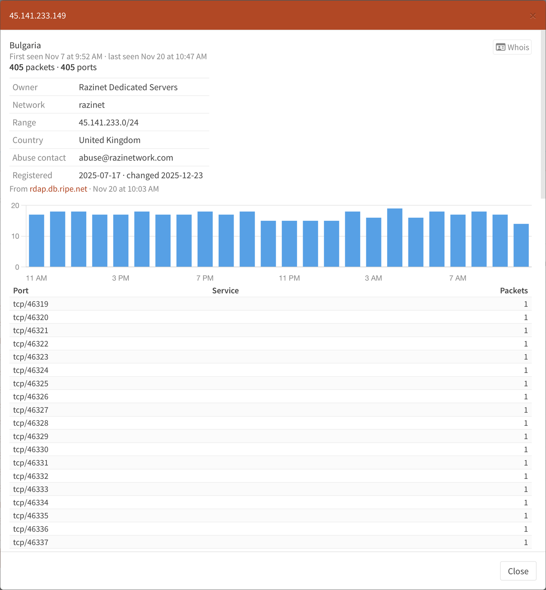
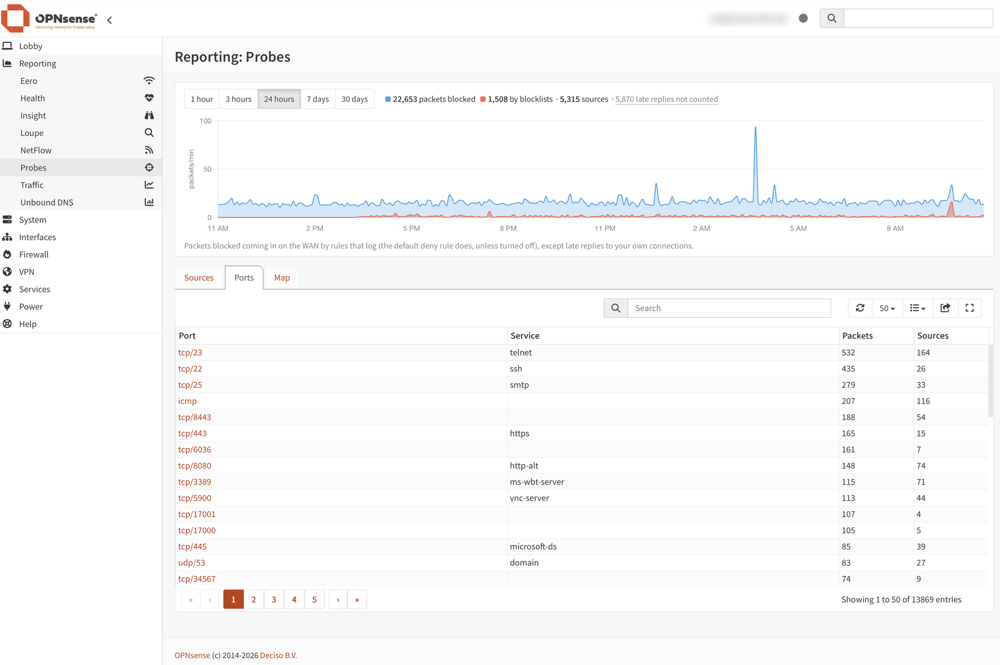
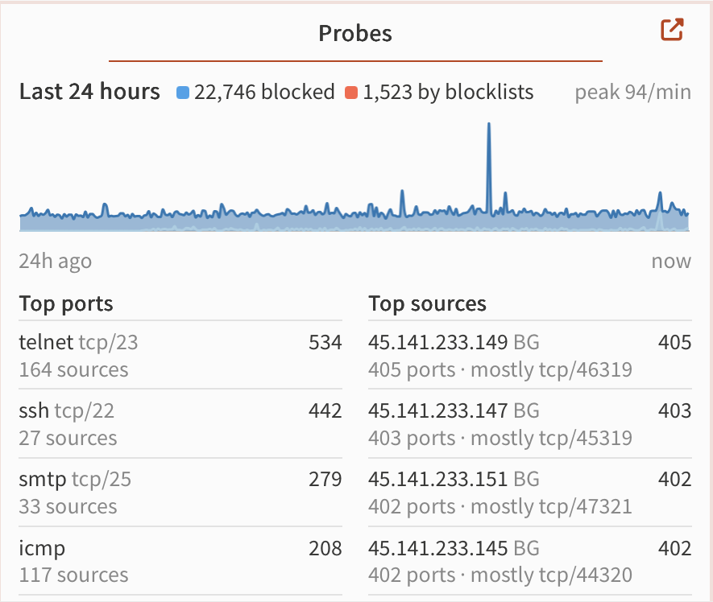

# Probes for OPNsense

The moment anything goes online, it's being probed. Within minutes of getting a public address, a connection is swept by scanners looking for an open port, bots trying default passwords on telnet, SSH and RDP, and exploit kits hunting for an unpatched camera, NAS or router. It never stops: thousands of attempts a day, from all over the world.

Your firewall blocks them and writes each one to a log nobody reads. **Probes reads it for you, and shows you who is trying to break in, how, and from where.**

Inside the OPNsense GUI, you get the probing over time, every source with its country, what it tried, which blocklist caught it and who owns its network, every port that gets tried and by how many, and a world map of where it all comes from. It answers questions like *"how much of this is going on?"*, *"who is the busiest scanner this week?"*, *"what did this address try?"*, *"who's been trying SSH?"*, *"how much is my blocklist actually catching?"* and *"where is all this coming from?"*


## Features

- **A graph** of packets blocked coming in on your WAN, per minute, for the last hour, 3 hours, 24 hours, 7 days or 30 days, as two lines: everything blocked, and what your blocklists (such as Spamhaus DROP or blocklist.de) blocked. The gap between them is what the blocklists didn't catch. Beside the totals, how the probing compares with everything that came in on the WAN: typically well under 0.1% of incoming packets.
- **Sources**: every address that was blocked, with its country, packets, how many ports it tried, the port it tried most, and when it was first and last seen. Pick a country from the list beside the search box (type to find it), or search by address, country name, or port (`23`: everyone who tried telnet; `udp/53`). Sources a blocklist blocked are tagged with the list's name, such as *Spamhaus DROP*.
- **A source's detail**: click one for its packets over time (per hour, or per 5 minutes for the last 1 or 3 hours), every port it tried, and a Whois button.
- **Ports**: every port (or protocol, such as ICMP) that was tried, with the service's name, packets and how many different sources tried it. Search by number, service name (`ssh`) or protocol. Click a port to list the sources that tried it.
- **Map**: a world map shaded by packets per country, with a legend scaled to the period, beside a list of countries. Click a country to list its sources.
- **Dashboard widget**: the last 24 hours at a glance, per 15 minutes, with the totals, the peak rate and the top ports and sources. Click a port or source to open it on the page.
- **Not fooled by your own traffic**: packets that are late replies to connections your network made are left out, and counted separately beside the totals. On a typical home connection that's a fifth to a quarter of everything blocked: cloud services (QUIC from Google and Meta), smart-home hubs talking to their makers' clouds, video calls, a peer-to-peer VPN trying ports. Without this, the busiest "probers" would be WhatsApp and your work VPN.
- **Fast**: the page loads at once, for any period: the totals are kept up to date in the background.
- **Whois**, on request: a button in a source's detail asks the address's regional registry (ARIN, RIPE, APNIC and so on, over RDAP) who it belongs to: the owner, the network and its range, the country it's registered in and where to report abuse.
- **Nothing leaves the router** unless you ask. Probes reads the firewall log OPNsense already writes and sends nothing anywhere; the one exception is the Whois button, which looks up that one address when you press it (answers are kept a week). For countries it uses OPNsense's own GeoIP feature (the one behind GeoIP aliases) when you've turned it on; Probes doesn't ship or download any GeoIP data itself.
- **No settings.** It finds your WAN interfaces and blocklist rules itself.

## Screenshots

**A source**: when it was active, and every port it tried.



**Ports**: what gets tried, and by how many sources.



**Map**: where the probing comes from.


**Dashboard widget**: the last 24 hours.



## What it counts

Packets **blocked coming in on a WAN interface**, as the firewall log records them. Traffic that's allowed in (to a port you forward, say) isn't a probe and isn't counted; neither is anything on your own networks.

- **A WAN** is any enabled interface with a gateway set (on the interface, or an upstream gateway for it in *System ▸ Gateways*), or an address obtained from the provider (DHCP, DHCPv6, PPPoE and the like). With several WANs, they're added together.
- **Only rules that log are in the log.** OPNsense's default deny rule logs unless *Firewall ▸ Settings ▸ Advanced ▸ Log packets that are blocked by the default rule* is turned off, so in a usual setup Probes sees nearly everything blocked. Your own block rules show up when they log.
- **A blocklist rule** is an enabled block or reject rule, inbound (or both directions), on a WAN (or floating), whose source is an alias filled from a URL: type *URL*, *URL Table* or *URL Table (JSON)*. For example [Spamhaus DROP](https://docs.opnsense.org/manual/how-tos/drop.html) in a URL Table alias. Only rules made in *Firewall ▸ Rules* are recognised (pf labels those with their ID); legacy rules are not.

**Late replies aren't counted.** Not everything blocked is a probe. When a connection your network made has closed or gone idle, the other end often keeps sending for a while (QUIC from big sites, video calls), and peer-to-peer VPNs (NetBird, Tailscale, WireGuard) try ports on your public address to find a direct path. The firewall blocks those too. Probes leaves out any blocked packet from an address your network connected to in the hour before, and shows how many it left out, and from where, beside the totals. Packets a blocklist rule blocked always count as probes. It knows what your network connected to from the firewall's open connections, checked every minute, and from outbound connections in the log when those are logged.

## Requirements

- OPNsense 26.7 or later.
- Logging of the default deny rule (on by default).
- For countries and the map: OPNsense's built-in GeoIP feature, turned on (below). Without it, everything else works; the country column, country filter and map are left out.

## Security

Probes only reads. It never changes firewall rules or touches packets, runs no daemon of its own and listens on no network port. Its pages and API are behind OPNsense's login and its own privilege, *Reporting: Probes*.

Its three scripts run as root, as every plugin's configd actions do: the collector (cron, every minute), the queries behind the page, and whois. Root is what lets them read the firewall log, `config.xml` and the firewall's state table (`pfctl -ss`), and write the database in `/var/db/probes/` (mode 750, owned by root).

- **What it reads from the outside world** is what the firewall log records about a blocked packet: its addresses, protocol and ports. A line is used only when its interface, action, direction and protocol are ones Probes expects, and ports only when they're numbers; everything is stored as bound parameters. Nothing else from a packet is read.
- **Input from the page** is checked twice: by the API (addresses must be addresses, periods and page sizes have limits, sorting is by a fixed list of columns, search text is cut down to letters, digits and a few separators) and again by the query script. Everything reaches SQLite as a bound parameter, never as part of the SQL. The queries open the database read-only.
- **Commands**: `pfctl` and Health's `rrdtool` are run with fixed arguments, never through a shell.
- **Untrusted text on the page** (addresses, and whois answers, which the network's owner partly writes) is escaped wherever it's shown, and a whois link is only made for an `https://` address.
- **Network**: the only outbound connections are whois lookups, over HTTPS to IANA and the regional registry, made only when you press *Whois*. No telemetry, no update checks, no CDN: the page uses OPNsense's own copies of Chart.js and d3, and the world map ships with the plugin.
- **The package** holds no compiled code. Its only install scripts restart cron (so the collector's job is added, or removed on uninstall) and remove Python's byte-code caches on uninstall; what's in this repository is what runs.

## Install

Probes installs from a package repository, [os-plugins](https://alokdhir.github.io/os-plugins/) (it isn't in the official plugin list: [plugins there wrap FreeBSD ports](https://github.com/opnsense/plugins/issues/5854)). Add the repository once, on the OPNsense box itself, from the console (option 8, *Shell*) or SSH, as root:

```sh
fetch -o /usr/local/etc/ssl/dhir-os-plugins.pub https://alokdhir.github.io/os-plugins/dhir-os-plugins.pub
fetch -o /usr/local/etc/pkg/repos/dhir-os-plugins.conf https://alokdhir.github.io/os-plugins/dhir-os-plugins.conf
pkg update
```

Then install **os-probes** from **System ▸ Firmware ▸ Plugins**; OPNsense shows its standard *Third party software* notice first, as it does for any package not from OPNsense. Updates arrive with OPNsense's own, under **System ▸ Firmware ▸ Updates**. The repository is signed: `pkg` checks everything it installs from it against the public key fetched above. The same repository has [Loupe](https://github.com/alokdhir/os-loupe) and [os-eero](https://github.com/alokdhir/os-eero).

Then open **Reporting ▸ Probes**. The first run reads up to 30 days of existing firewall log, so there's history straight away; on a busy log that takes a minute or two.

For development, `ROUTER=user@router tools/deploy.sh` copies your working tree to a router over SSH and installs it there (`tools/install.sh`, without the package; `tools/deploy.sh uninstall` removes it). `PROBES_SSH` adds ssh options, e.g. `PROBES_SSH="ssh -i ~/.ssh/router_key"`. Packages are built and published by `tools/publish.sh` in [os-plugins](https://github.com/alokdhir/os-plugins); a changed plugin needs a new `PLUGIN_VERSION` or `PLUGIN_REVISION`.

### Countries (GeoIP)

Probes doesn't bring its own country data. OPNsense already has a GeoIP feature, built for GeoIP aliases (firewall rules by country), and Probes uses the database it downloads. It's off until you give it a download URL, in *Firewall ▸ Aliases ▸ GeoIP settings* (an odd place for it, since that's its only use in OPNsense). If you already use GeoIP aliases, there's nothing to do. Otherwise, with MaxMind's free GeoLite2:

1. Sign up for a free account at [maxmind.com](https://www.maxmind.com/en/geolite2/signup).
2. In your account, *Manage License Keys ▸ Generate new license key*. A new key can take a few minutes to start working.
3. In *Firewall ▸ Aliases ▸ GeoIP settings*, set the URL to the following, with your key in place of `YOUR_KEY`, and *Apply*:
   ```
   https://download.maxmind.com/app/geoip_download?edition_id=GeoLite2-Country-CSV&license_key=YOUR_KEY&suffix=zip
   ```
4. To keep it current, add a job in *System ▸ Settings ▸ Cron* with the command *Update GeoIP database*, e.g. Wednesdays and Saturdays (MaxMind publishes on Tuesdays and Fridays).

Probes picks the database up within a minute, and again whenever it's updated.

## How it works

- **Collector**: a cron job runs every minute (`configctl probes collect`). It reads only the firewall log lines written since its last run (`/var/log/filter/`), keeps the blocks that came in on a WAN, and adds them to hourly totals per source and port (5-minute ones for the last 3 hours) and per-minute totals for the graph, in an SQLite database (`/var/db/probes/probes.db`). It also notes which blocklist blocked each source. A minute's run takes a fraction of a second.
- **Countries**: when OPNsense's GeoIP database changes, the collector copies its country lists into Probes' own database, and looks each new source up once.
- **Period totals**: every 5 minutes (every minute for the 1- and 3-hour periods), the collector adds up each source, port and country for the page's five periods, so the page and widget read ready totals instead of adding up hundreds of thousands of rows. The graph and totals are up to a minute old, the lists and map up to five (one for the short periods).
- **Retention**: 30 days. The database is roughly 90 MB for a month of a typical home connection, about 35 MB of it the GeoIP lists.
- **Late replies**: the collector notes which addresses your network connects to, from outbound passes in the log and the firewall's open connections (`pfctl -ss`) every minute, and counts a blocked packet from one of them in the hour after as a reply instead of a probe.
- **Compared with all WAN traffic**: everything that came in (packets and bytes, allowed and blocked) comes from the graphs OPNsense's Health already keeps per interface (`/var/db/rrd/<interface>-packets.rrd` and `-traffic.rrd`), read when the page asks, so it has their history straight away. A counter reset (a reboot) shows there as an impossible spike; those rows are left out. Without Health's graphs, the comparison is left out.
- **Whois**: `configctl probes whois <ip>` asks IANA which registry holds the address (its list is kept a month) and that registry's RDAP service; the answer is kept a week.
- **API**: the page and widget read `/api/probes/report/summary/<hours>`, `search_sources`, `search_ports`, `source/<ip>/<hours>` (configd `probes query`) and `whois/<ip>` (configd `probes whois`). The ACL entry is *Reporting: Probes*. Links into the page: `/ui/probes/#source=<ip>` opens a source, `/ui/probes/#port=tcp/23` lists the sources that tried a port.

## Uninstall

Removing the package (`pkg delete os-probes`, or System ▸ Firmware ▸ Plugins) removes the plugin and its cron job, and keeps the database in `/var/db/probes/`; delete that directory to remove it too.

## Development

```
src/etc/inc/plugins.inc.d/probes.inc               cron job
src/opnsense/scripts/probes/collect.py             collector
src/opnsense/scripts/probes/query.py               queries for the page and widget
src/opnsense/scripts/probes/whois.py               whois (RDAP) for the Whois button
src/opnsense/scripts/probes/common.py              database schema, WANs and blocklist rules
src/opnsense/service/conf/actions.d/               configd actions
src/opnsense/mvc/app/controllers/OPNsense/Probes/  page and API
src/opnsense/mvc/app/views/OPNsense/Probes/        the page
src/opnsense/www/js/widgets/                       dashboard widget
src/opnsense/www/js/probes/world.json              country outlines for the map
```

`tools/deploy.sh` copies the tree to the router and installs it where the package would (`src/` → `/usr/local`).

## See also

[**Loupe**](https://github.com/alokdhir/os-loupe) is Probes' opposite. Probes shows the traffic coming in from the internet that your firewall stops. Loupe shows the traffic going out, and from which device on your network: which site or service each one talked to, how much and when.

## License

BSD 2-Clause, see [LICENSE](LICENSE). The world map is [Natural Earth](https://www.naturalearthdata.com/) (public domain), reduced; see `src/opnsense/www/js/probes/world.json.LICENSE`.
