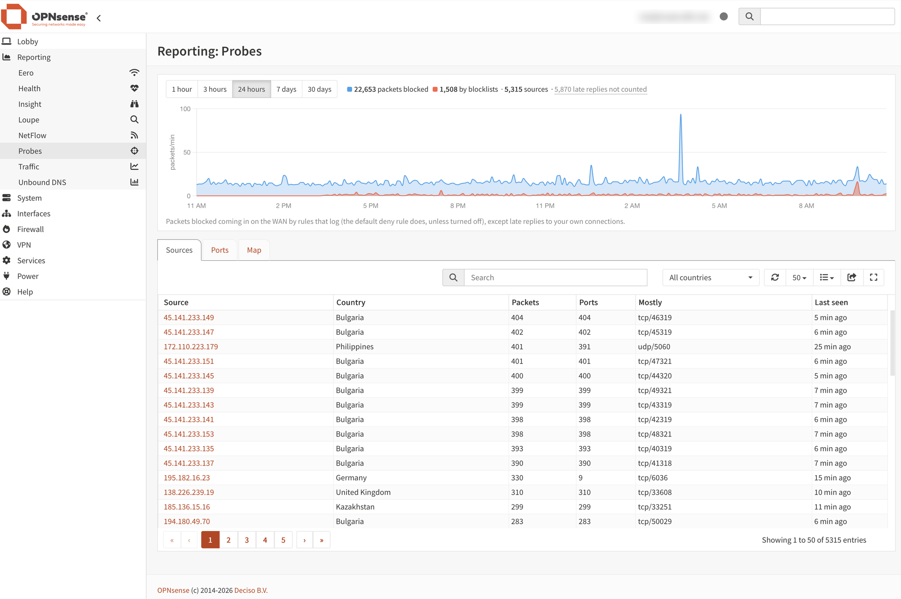
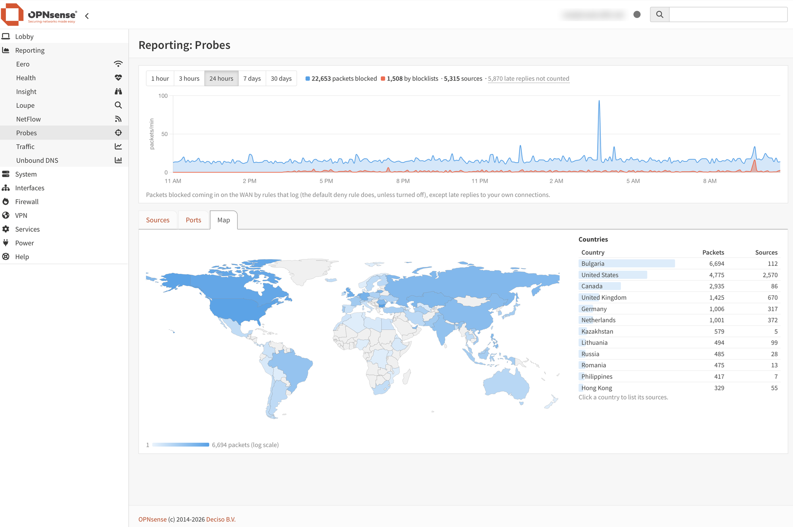

# Probes for OPNsense

The moment anything goes online, it's being probed. Within minutes of getting a public address, a connection is swept by scanners looking for an open port, bots trying default passwords on telnet, SSH and RDP, and exploit kits hunting for an unpatched camera, NAS or router. It never stops: thousands of attempts a day, from all over the world.

Your firewall blocks them and writes each one to a log nobody reads. **Probes reads it for you, and shows you who is trying to break in, how, and from where.**

Inside the OPNsense GUI, you get the probing over time, every source with its country and what it tried, every port that gets tried and by how many, and a world map of where it all comes from. It answers questions like *"how much of this is going on?"*, *"who is the busiest scanner this week?"*, *"what did this address try?"*, *"who's been trying SSH?"*, *"how much is my blocklist actually catching?"* and *"where is all this coming from?"*



## Features

- **A graph** of packets blocked coming in on your WAN, per minute, for the last hour, 3 hours, 24 hours, 7 days or 30 days, as two lines: everything blocked, and what your blocklists (such as Spamhaus DROP) blocked. The gap between them is what the blocklists didn't catch.
- **Sources**: every address that was blocked, with its country, packets, how many ports it tried, the port it tried most, and when it was first and last seen. Filter by country, search by address, or by port (`23`: everyone who tried telnet). Sources blocked by a blocklist are tagged.
- **A source's detail**: click one for its packets over time (per hour, or per 5 minutes for the last 1 or 3 hours) and every port it tried.
- **Ports**: every port (or protocol, such as ICMP) that was tried, with the service's name, packets and how many different sources tried it. Search by number, service name (`ssh`) or protocol.
- **Map**: a world map shaded by packets per country, beside a list of countries. Click a country to list its sources.
- **Dashboard widget**: the last 24 hours at a glance, with the totals, the peak rate and the top five ports and sources.
- **Fast**: the page loads at once, for any period: the totals are kept up to date in the background.
- **Nothing leaves the router.** Probes reads the firewall log OPNsense already writes; it looks nothing up online and sends nothing anywhere. Countries come from the GeoIP database OPNsense itself downloads for GeoIP aliases.
- **No settings.** It finds your WAN interfaces and blocklist rules itself.

## Screenshots

**A source**: when it was active, and every port it tried.


**Ports**: what gets tried, and by how many sources.


**Map**: where the probing comes from.



**Dashboard widget**: the last 24 hours.


## What it counts

Packets **blocked coming in on a WAN interface**, as the firewall log records them. Traffic that's allowed in (to a port you forward, say) isn't a probe and isn't counted; neither is anything on your own networks.

- **A WAN** is any enabled interface with a gateway set, or an address obtained from the provider (DHCP, DHCPv6, PPPoE and the like). With several WANs, they're added together.
- **Only rules that log are in the log.** OPNsense's default deny rule logs unless *Firewall ▸ Settings ▸ Advanced ▸ Log packets that are blocked by the default rule* is turned off, so in a usual setup Probes sees nearly everything blocked. Your own block rules show up when they log.
- **A blocklist rule** is an enabled block or reject rule, inbound (or both directions), on a WAN (or floating), whose source is an alias filled from a URL: type *URL*, *URL Table* or *URL Table (JSON)*. For example [Spamhaus DROP](https://docs.opnsense.org/manual/how-tos/drop.html) in a URL Table alias. Only rules made in *Firewall ▸ Rules* are recognised (pf labels those with their ID); legacy rules are not.

Not everything blocked is hostile. Most of it is port scans and login attempts, but a few packets are late arrivals from connections that already closed, and peer-to-peer VPNs (NetBird, Tailscale, WireGuard) try a port on your public address to find a direct path; if nothing answers there, those attempts show up too. A source sending a steady trickle to one UDP port is usually that.

## Requirements

- OPNsense 26.7 or later.
- Logging of the default deny rule (on by default).
- For countries and the map: the GeoIP database (below). Without it, everything else works; the country column, country filter and map are left out.

## Install

From a package repository that carries it (`os-probes`), or for development, from this repository over SSH:

```sh
ROUTER=root@192.168.1.1 tools/deploy.sh              # install or update
ROUTER=root@192.168.1.1 tools/deploy.sh uninstall    # remove
```

`PROBES_SSH` adds ssh options, e.g. `PROBES_SSH="ssh -i ~/.ssh/router_key"`. `tools/install.sh` and `tools/uninstall.sh` do the same on the router itself.

Then open **Reporting ▸ Probes**. The first run reads up to 30 days of existing firewall log, so there's history straight away; on a busy log that takes a minute.

### Countries (GeoIP)

OPNsense downloads a country database for its GeoIP aliases, and Probes uses the same one. Its settings live, a little oddly, under *Firewall ▸ Aliases ▸ GeoIP settings*. With MaxMind's free GeoLite2:

1. Sign up for a free account at [maxmind.com](https://www.maxmind.com/en/geolite2/signup).
2. In your account, *Manage License Keys ▸ Generate new license key*. A new key can take a few minutes to start working.
3. In *Firewall ▸ Aliases ▸ GeoIP settings*, set the URL to the following, with your key in place of `YOUR_KEY`, and *Apply*:
   ```
   https://download.maxmind.com/app/geoip_download?edition_id=GeoLite2-Country-CSV&license_key=YOUR_KEY&suffix=zip
   ```
4. To keep it current, add a job in *System ▸ Settings ▸ Cron* with the command *Update GeoIP database*, e.g. Wednesdays and Saturdays (MaxMind publishes on Tuesdays and Fridays).

Probes picks the database up within a minute, and again whenever it's updated.

## How it works

- **Collector**: a cron job runs every minute (`configctl probes collect`). It reads only the firewall log lines written since its last run (`/var/log/filter/`), keeps the blocks that came in on a WAN, and adds them to hourly totals per source and port, and 5-minute totals for the graph, in an SQLite database (`/var/db/probes/probes.db`). A minute's run takes a fraction of a second.
- **Countries**: the collector copies OPNsense's GeoIP lists into the database when they change, and looks each new source up once.
- **Period totals**: every 5 minutes, the collector adds up each source, port and country for the page's three periods, so the page and widget read ready totals instead of adding up hundreds of thousands of rows. The graph and totals are up to a minute old, the lists and map up to five.
- **Retention**: 30 days. The database is roughly 40 MB for a month of a typical home connection, plus about 35 MB for the GeoIP lists.
- **API**: the page and widget read `/api/probes/report/summary/<hours>`, `search_sources`, `search_ports` and `source/<ip>/<hours>` (configd `probes query`). The ACL entry is *Reporting: Probes*.

## Uninstall

`tools/deploy.sh uninstall` (or removing the package) removes the plugin and its cron job, and keeps the database in `/var/db/probes/`; delete that directory to remove it too.

## Development

```
src/etc/inc/plugins.inc.d/probes.inc               cron job
src/opnsense/scripts/probes/collect.py             collector
src/opnsense/scripts/probes/query.py               queries for the page and widget
src/opnsense/scripts/probes/common.py              database schema, WANs and blocklist rules
src/opnsense/service/conf/actions.d/               configd actions
src/opnsense/mvc/app/controllers/OPNsense/Probes/  page and API
src/opnsense/mvc/app/views/OPNsense/Probes/        the page
src/opnsense/www/js/widgets/                       dashboard widget
src/opnsense/www/js/probes/world.json              country outlines for the map
```

`tools/deploy.sh` copies the tree to the router and installs it where the package would (`src/` → `/usr/local`).

## License

BSD 2-Clause, see [LICENSE](LICENSE). The world map is [Natural Earth](https://www.naturalearthdata.com/) (public domain), reduced; see `src/opnsense/www/js/probes/world.json.LICENSE`.
